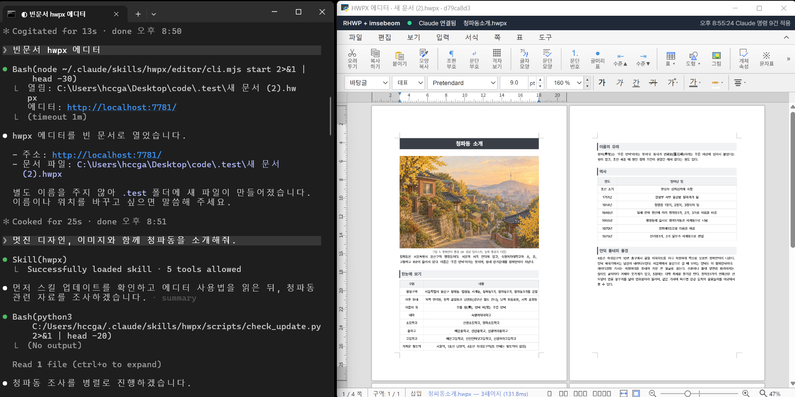

# hwpx-skill



**터미널에서 Claude 에게 말하면, 옆의 한글 에디터 창에서 문서가 실시간으로 만들어지고 고쳐집니다.** 한컴오피스 없이 돌아가며, 에디터 화면은 한/글 2024 와 같은 줄, 같은 쪽이 되도록 맞춰 두었습니다(아래 [에디터 모드](#에디터-모드-2026-09-25)).

HWPX(한컴오피스 한글 개방형 문서) 생성, 편집, 병합을 위한 Claude Code 커스텀 스킬.

## 참조 및 크레딧

이 스킬은 다음 오픈소스 프로젝트·문서·라이브러리를 참조·활용하여 만들어졌습니다.
각 프로젝트 저자와 기여에 감사드립니다.

| 구분 | 프로젝트 / 자료 | 라이선스 | 기여 / 참조 범위 |
|------|-----------------|----------|------------------|
| 기반 fork | [jkf87/hwpx-skill](https://github.com/jkf87/hwpx-skill) | 원본 라이선스 | 최초 기반. ZIP-level 치환 워크플로우, 템플릿 구조, 기본 빌드 패턴 |
| 알고리즘 포팅 | [edwardkim/rhwp](https://github.com/edwardkim/rhwp) | MIT (© 2025-2026 Edward Kim) | 표 계산식 엔진, 네임스페이스 헬퍼, UTF-16 오프셋, zip bomb 방어, 필드 API 포팅 (2026-04-18) |
| 에디터 엔진 | [edwardkim/rhwp](https://github.com/edwardkim/rhwp) v0.8.6 (rhwp-studio + WASM) | MIT (© 2025-2026 Edward Kim) | 에디터 모드의 화면과 조판 엔진. `editor/setup.mjs` 가 태그 판을 받아 로컬에서 빌드하며 저장소에는 넣지 않는다. `editor/patches/*.rs` 는 rhwp 소스를 고친 조각이다 (2026-09-25) |
| 결함 제보 참고 | [pblsketch/openoffice](https://github.com/pblsketch/openoffice) (이음오피스) | Apache-2.0 | 같은 rhwp 엔진에 얹은 패치 0009(셀 영역 배경이 병합 칸에서 끊김)를 보고 우리 엔진에서도 같은 결함을 찾았다. 코드는 가져오지 않았고 한/글 사본 실험으로 규칙을 다시 확인해 `cellzone-span` 패치로 고쳤다 (2026-10-22) |
| 편집 도구 | 형제 프로젝트 hwpx에디터기반AI | 자체 | `editor/plugin/lib/` 편집 도구 25종, 스냅샷 보호, 문서 개요, 행정문서 검수 (고치지 않고 복사, `SOURCE.md`) |
| 앱 창 | [pywebview](https://github.com/r0x0r/pywebview) | BSD-3-Clause | 에디터 앱 창(WebView2). 한/글 단축키(Ctrl+N 계열)를 받기 위해 브라우저 탭 대신 쓴다 |
| 외부 검증 도구 | [PolarisOffice/polaris_dvc](https://github.com/PolarisOffice/polaris_dvc) | Apache-2.0 | `bin/polaris-dvc.exe` (v0.1.0 prebuilt) — `verify_hwpx --strict` 의 JID 위반 검출 백엔드 (2026-04-26) |
| 스크립트 이식 | [airmang/hwpx-skill](https://github.com/airmang/hwpx-skill) | Apache-2.0 (© 2026 airmang) | `scripts/zip_replace_all.py` ZIP-level 전역 치환 + temp 안전 처리 + `mimetype ZIP_STORED` 보존 (2026-05-05). lineSegArray 더미 주입은 자체 보강 |
| 알고리즘 재구현 | [Canine89/hwpxskill](https://github.com/Canine89/hwpxskill) | 라이선스 미지정 | `scripts/page_guard.py` 레퍼런스 대비 페이지 드리프트 가드 (메트릭 비교 알고리즘 참조 후 다중 섹션·`xpath_local`·zip bomb 상한 추가하여 독립 재구현) (2026-05-05) |
| 스크립트 이식 | [chrisryugj/kordoc](https://github.com/chrisryugj/kordoc) | MIT (© 2026 chrisryugj) | `scripts/gongmun_lint.py` 공문서 표기법 검수, `scripts/seal_hwpx.py` 도장 날인, `scripts/chart_hwpx.py` 한글 네이티브 차트. TypeScript 를 파이썬 표준 라이브러리로 옮겼고 실행 때 kordoc 이나 네트워크를 쓰지 않는다 (2026-09-28) |
| 알고리즘 원전 | [DoHyun468/claw-hwp](https://github.com/DoHyun468/claw-hwp) | MIT (© 2026 DoHyun468) | kordoc 이 가져온 차트 조립과 종류 표, 도장 배치 방식의 원전 (2026-09-28) |
| 스펙 자료 | 한글과컴퓨터 HWP 파일 형식 공개 문서 | 공개 | HWPX XML 스키마 해석 기준 |
| 기본 글꼴 | [orioncactus/pretendard](https://github.com/orioncactus/pretendard) v1.3.9 | SIL OFL 1.1 (© 2021 Kil Hyung-jin, Reserved Font Name Pretendard) | `fonts/Pretendard-Regular.ttf`, `Pretendard-Bold.ttf` 원본 그대로 동봉, 라이선스 전문 `fonts/OFL.txt`. 보고서, 회의록, 제안서, 기본 템플릿의 글꼴이며 rhwp PDF 가 쓴다 (2026-10-02) |
| Python 라이브러리 | `lxml` / `python-hwpx 2.9.1+` / `Pillow` | 각 라이브러리 라이선스 | XML 파싱·편집, HWPX 읽기·`HwpxDocument` API, 이미지 처리 |

**상세 참조**: 원본 fork 대비 변경 사항은 아래 "원본(jkf87) 대비 변경 사항" 참조.
rhwp 포팅 상세는 [`references/rhwp-benchmark.md`](references/rhwp-benchmark.md),
제3자 라이선스 전문은 [`THIRD_PARTY_NOTICES.md`](THIRD_PARTY_NOTICES.md) 참조.

## 원본(jkf87) 대비 변경 사항

### 추가된 모듈

| 파일 | 기능 | 원본에 없는 이유 |
|------|------|------------------|
| `hwpx_modifier.py` | 기존 양식 세밀 수정 (정규식 치환, 인덱스 기반 수정, 문단 들여쓰기 제어) | 원본은 새 문서 생성 중심. 기존 문서의 문단 속성 세밀 조작 기능 없음 |
| `hwpx_form_filler.py` | 양식 부분 추출, 표 구조 분석, 좌표 기반 셀 채우기, 행 추가/복제 | 원본은 ZIP-level 문자열 치환만 지원. 표 구조 변경 불가 |
| `hwpx_writer.py` | hp:switch 구조 줄간격 XML 생성 | 원본에 줄간격 관련 함수 없음 |

### 코드 수정

| 파일 | 변경 내용 |
|------|-----------|
| `md2hwpx.py` | 표 열 너비: 균등 배분 → **내용 길이 비례 배분** (한글=2, ASCII=1 가중치). 셀 여백 확대 (좌우 1mm, 상하 0.5mm). `hasMargin="1"` 활성화 |
| `templates/report/header.xml` | 모든 paraPr의 `borderFillIDRef`를 `"1"`로 변경 (문단 가로선 제거). `diagonal type="SOLID"` → `"NONE"` |
| `zip_replace_all.py`, `clone_form.py` (2026-09-15) | 텍스트 치환 범위를 **`<hp:t>` 안의 글자만**으로 바꿈(`hwpx_helpers.replace_in_text_nodes`). XML 전체 치환은 `--raw` 로만. AI가 만든 편집 스크립트가 「7→4」 같은 짧은 키로 XML 전체를 치환해 쪽 높이·여백·셀 주소가 깨지고 한글이 멈춘 사고에서 |
| `validate.py` (2026-09-15) | XML 유효성에 더해 **쪽 크기 상식 검사**(pagePr 10,000~300,000 HWPUNIT)와 **표 격자 검사**(cellAddr 중복·빈 칸)를 넣음. 위 사고 파일이 유효성만으로는 「정상」이었다 |
| `fix_namespaces.py` (2026-09-25, 10-02 rhwp 로 교체) | 명령줄로 실행하면 마지막에 **더미 줄 배치를 걷고 rhwp 로 잰 표 높이**를 넣는다(`rhwp_convert.apply_layout`, 9/25~10/1 은 한글 COM). 빌더가 넣는 한 줄짜리 더미 줄 배치는 한글만 무시하고 rhwp 같은 다른 구현체는 그대로 믿어 문단이 한 줄로 눌리거나 표가 겹쳤다. Node.js 가 없으면 경고만 내고 그대로 둔다. `--no-layout` 또는 `HWPX_NO_LAYOUT=1` 로 끈다 |
| `scripts/hancom_layout.py` (2026-09-25 신규, **10-02 삭제**) | 사본을 한글로 열어 쪽수를 읽어 조판을 끝낸 뒤 저장하고, 줄 배치는 문단끼리, 표 `hp:sz height` 는 표끼리 짝지어 원본에 옮겨 심는다(한글 재저장본을 통째로 쓰면 그림이 BMP 로 부푼다). 한글 호출 잠금과 RPC 오류 재시도 포함 |

### 추가된 워크플로우

| 워크플로우 | 용도 |
|-----------|------|
| **G** (HwpxModifier) | 기존 양식의 정규식 치환, 인덱스 수정, 들여쓰기 조정 |
| **H** (HwpxFormFiller) | 붙임/별지 섹션 추출, 표 좌표 기반 셀 채우기, 행 추가/복제 |
| **I** (병합) | 여러 HWPX 파일을 lxml 파서로 안전하게 병합 |

### SKILL.md 확장

- md2hwpx.py 직접 사용법 (`--template` 옵션) 문서화
- 이미지 인라인 삽입 전체 코드 예시 (ZIP 추가 + section0.xml hp:pic 삽입 2단계)
- HWPX 병합 코드 예시 (lxml 기반, ID 오프셋, 페이지 넘김)
- Critical Rules #16~22 추가

### 트러블슈팅 추가 (references/troubleshooting.md)

- "문단마다 가로선이 표시됨" — paraPr borderFillIDRef 원인 및 해결
- "이미지가 ZIP에는 있지만 문서에 안 보임" — 인라인 삽입 절차

## 설치

```bash
# Claude Code 스킬 디렉토리에 클론
git clone https://github.com/imsebeom/hwpx.git ~/.claude/skills/hwpx

# 의존성
pip install lxml Pillow

# 에디터 모드를 쓸 때만 (Node 22+ 필요, 최초 1회)
pip install pywebview                      # 앱 창(없으면 브라우저 탭으로 연다)
node ~/.claude/skills/hwpx/editor/setup.mjs   # 미리 빌드한 에디터 받기(17MB) → editor/studio-dist/
```

**업데이트 알림**(2026-10-14): 스킬을 쓰는 대화에서 Claude 가 `scripts/check_update.py` 로 하루 한 번 GitHub 를 확인하고, 새 변경이 있으면 목록을 보여 주고 받을지 묻는다. 직접 받으려면 `git -C ~/.claude/skills/hwpx pull` 뒤 에디터가 바뀌었으면 `node ~/.claude/skills/hwpx/editor/setup.mjs`.

**`setup.mjs` 는 먼저 GitHub 릴리스의 미리 빌드한 에디터를 받는다**(2026-10-02). `editor/prebuilt.json` 의 원본 지문(`patches/`, `plugin/`, `setup.mjs`)이 받은 스킬과 같으면 그 묶음(엔진 패치가 모두 든 WASM 과 화면)을 받아 sha256 을 확인하고 푼다 — Rust 도 rhwp 소스도 필요 없다. 지문이 달라도(관리자가 릴리스를 빠뜨린 경우) 빌드하지 않고 지난 묶음을 받으며 경고만 낸다. 받기는 주소마다 세 번 시도하고, 그래도 실패하면 빌드로 넘어가지 않고 멈춘다(2026-10-03, 공유받은 PC 가 모르는 새 10분 넘게 빌드하던 것). 직접 빌드는 `--build` 일 때만 한다: Rust(`~/.cargo` 의 cargo, wasm-pack)가 있으면 `editor/patches/` 를 넣어 WASM 을 빌드하고, 없으면 npm 의 공식 WASM 을 쓴다(그때는 아래 「에디터 모드」의 엔진 패치가 빠진다).
관리자는 엔진이나 플러그인을 고친 뒤 `node editor/setup.mjs --build` → `node editor/release.mjs`(gh 로그인 필요)로 hwpx, hwpx2 릴리스에 새 묶음을 올리고 `prebuilt.json` 을 커밋한다.

**한글(한컴오피스)이 없어도 된다(2026-10-02).** HWP→HWPX 변환, 빌드 마지막 줄 배치 보정, 양식 미리보기 PDF 를 모두 rhwp 로 한다(`scripts/rhwp_convert.py`). 엔진은 처음 쓸 때 받아 캐시에 둔다.

- rhwp CLI: GitHub 릴리스의 미리 빌드본(Windows, macOS, Linux, 약 10MB)을 받아 `SHA256SUMS.txt` 로 확인하고 `~/.cache/rhwp/<버전>` 에 둔다. HWP→HWPX 와 PDF 에 쓴다.
- WASM 엔진: 줄 배치 보정에 쓴다. 에디터 빌드가 있으면 그것을, 없으면 npm `@rhwp/core`(약 4MB)를 `~/.cache/rhwp-core/<버전>` 에 받는다. **Node.js(npm 포함)가 필요하다.**

기본 글꼴은 동봉한 Pretendard(`fonts/`, OFL)다. 공문과 정부 양식 템플릿만 함초롬, 휴먼명조 계열을 그대로 둔다. 받는 사람 PC 에 Pretendard 가 없으면 한글이 다른 글꼴로 보여 주므로, 남에게 보낼 문서는 PDF 를 함께 보낸다.

버전은 `editor/setup.mjs` 의 `RHWP_VERSION` 을 따른다. 한글이 설치된 PC 에서 대조한 결과, rhwp 변환본과 줄 배치 보정본을 한글로 열면 한컴 COM 결과와 픽셀까지 같았다(공문 3~4건). rhwp 가 그리는 PDF 는 한글과 표, 그림, 쪽 구성이 같고 일부 글리프와 대체 글꼴만 다르다.

## 워크플로우 요약

| 워크플로우 | 용도 | 주요 도구 |
|-----------|------|-----------|
| A | 마크다운/텍스트 → HWPX | hwpx_helpers.py, md2hwpx.py |
| B | 템플릿 플레이스홀더 치환 | ZIP-level str.replace() |
| C | 기존 문서 XML 편집 | office/unpack.py → pack.py |
| D | 참조 양식 기반 새 문서 | analyze_template.py + build_hwpx.py |
| E | 읽기/텍스트 추출 | text_extract.py |
| F | 양식 복제 (구조 100% 보존) | clone_form.py |
| G | 세밀 수정 (정규식, 들여쓰기) | hwpx_modifier.py |
| H | 표 조작 (셀 채우기, 행 추가) | hwpx_form_filler.py |
| I | 여러 HWPX 병합 | lxml 기반 문단 복사 |
| J | 시험 문제지 생성 (PDF→HWPX) | exam_builder.py |
| K | HWP(바이너리) → HWPX 변환 | hwp_to_hwpx_hancom.py (rhwp CLI, 한글 불필요). 폴백 convert_hwp.py (jkf87/hwp2hwpx-python-refactor) |
| L | ZIP-level 전역 치환 (양식 표 셀 포함) | zip_replace_all.py (airmang 이식 + lineseg 통합) |
| M | 스타일 필터 텍스트 치환 (글자 색·밑줄·charPrIDRef·limit) | style_filter_replace.py (python-hwpx 2.x) |
| N | 자동 첨삭 메모 batch 삽입 (학생 작품 평가 자동화) | add_review_memo.py (python-hwpx 2.x) |
| O | 레퍼런스 99% 복원 + 쪽수 드리프트 가드 | page_guard.py (Canine89 알고리즘 재구현) |
| 에디터 모드 | 사용자가 에디터 창으로 보며 고치고 Claude 가 같은 문서를 실시간으로 고친다 | `editor/cli.mjs` (설명서 `references/editor-mode.md`) |
| 표기법 검수 | 공문, 계획서의 날짜, 시간, 금액, 붙임, 쌍점, 물결표, 두음법칙, 외래어, 차별 표현, 「끝.」 누락 | `gongmun_lint.py` (kordoc 이식) |
| 도장 날인 | 「(인)」, 「(서명)」 위에 도장 그림을 글 앞으로 띄워 넣는다. 칸과 쪽 높이는 그대로 | `seal_hwpx.py` (kordoc 이식) |
| 네이티브 차트 | JSON, CSV 자료로 막대, 꺾은선, 원, 도넛, 영역, 방사형, 분산 등 20종을 한글에서 고칠 수 있는 차트로 넣는다 | `chart_hwpx.py` (kordoc 이식) |

## kordoc 이식 (2026-09-28)

[chrisryugj/kordoc](https://github.com/chrisryugj/kordoc)(MIT)의 기능 셋을 **파이썬 표준 라이브러리만으로** 옮겼다. 설치할 것이 없다.

```bash
S=~/.claude/skills/hwpx/scripts
python $S/gongmun_lint.py 결과.hwpx --document                        # 위반이 있으면 종료 코드 1
python $S/seal_hwpx.py 서식.hwpx 날인본.hwpx --image 도장.png --anchor "(인)" --occurrence all
python $S/chart_hwpx.py 문서.hwpx 차트본.hwpx --data 자료.csv --type line --anchor "<그림 1>"
```

| 파일 | 원본과 다른 점 (한글 PDF 로 확인) |
|------|------|
| `gongmun_lint.py` | AI 문체 규칙 두 개(줄표, 굵게 남용)는 옮기지 않았다. 같은 원고에서 나머지 위반 건수는 kordoc 과 같다 |
| `seal_hwpx.py` | 한글은 칸 안 도장의 세로 위치를 칸이 아니라 **표 위**에서 잰다. 그래서 앞 행 높이와 칸 위 여백을 더하고, 저장된 줄 배치로 문구가 든 줄을 찾는다. 고정폭 빈칸(0.25em), 장평과 자간도 반영했다. 기본은 문구 위에 겹쳐 찍기다. 서식 3종 14곳에서 도장 중심이 문구 중심과 4pt 안에 들었다. 쪽을 넘는 긴 칸 뒤쪽 문구는 한글이 도장을 앞 쪽에 걸어 경고만 낸다 |
| `chart_hwpx.py` | 원 3D 는 `firstSliceAng` 을 빼고 `view3D` 를 넣어야 한글이 조각을 그린다. JSON, CSV 입력과 문구 앞뒤 삽입을 더했다. 14종을 한글에서 확인했다 |

## 에디터 모드 (2026-09-25)

rhwp-studio 를 로컬에서 띄워, 사용자는 에디터 창에서 보며 고치고 Claude 는 같은 문서를 다시 열지 않고 실시간으로 고친다. 명령과 도구 전체는 [`references/editor-mode.md`](references/editor-mode.md).

```bash
E="node ~/.claude/skills/hwpx/editor/cli.mjs"
$E start 문서.hwpx        # 앱 창으로 연다
$E changes               # 사용자가 에디터에서 고친 내역(좌표 diff, 커서, 선택 글자)
$E run ops.json          # 편집 도구 25종 또는 WASM 직접 호출. 배치 하나가 undo 한 번
$E save                  # 새 판 <이름>_<YYMMDD>_<NN>.hwpx 로 저장(덮어쓰지 않음)
$E log                   # 작업 기록(시작, 불러옴, 편집, 화면 저장 포함 저장, 종료, 오류)
$E list                  # 떠 있는 에디터 전부
$E stop
```

| 기능 | 내용 |
|------|------|
| 실시간 공동 편집 | Claude 의 수정이 화면에 바로 반영되고, 사용자 편집은 좌표로 읽힌다. 한/글 단축키(Ctrl+N,T 표 등)는 앱 창에서 모두 된다 |
| 세션마다 에디터 하나 | 상태 폴더 `~/.claude/cache/hwpx-editor/<세션 ID 앞 8자>/`, 포트 7780 부터 빈 것. 여러 Claude 세션이 동시에 써도 서로의 문서를 덮어쓰지 않는다. `HWPX_EDITOR_INSTANCE` 로 이름을 줄 수 있다 |
| 작업 기록 | `editor-log.jsonl` 에 비우지 않고 쌓인다. 에디터 화면에서 저장한 것도 파일 이름과 크기로 남는다(브라우저가 전체 경로를 주지 않는다) |
| 열 때 조판 보정 | 더미 줄 배치나 줄 배치가 빠진 문서는 rhwp 로 표 높이를 재서 적은 판을 연다(`editor/rhwp_layout.mjs`). 원본 파일은 건드리지 않는다. 한글은 쓰지 않는다 |
| 편집 개선 (09-27~28) | 개체 옆 캐럿과 입력, 삭제, 선택 위치 맞춤(캐럿 축), F5 셀 블록에서 표, 셀, 문단, 글자 모양 대화상자, 글자 색 목록, 표와 그림 끌어 옮기기(끄는 동안 푸른 선, 놓을 때 문단째 이동), 그림 자르기, 칸 안 그림 크기 조절 뒤 칸 높이 = max(적힌 높이, 내용), 칸을 고친 뒤 표 높이와 쪽 나누기를 한글 방식(저장 줄 배치 사다리)으로 맞춤, Ctrl+위/아래 행 크기 조절, 창 닫을 때 저장 확인 |
| 편집 개선 (10-07~21) | 표 속 표 끌어 옮기기, 칸 여러 열(행)을 고르고 끝 테두리를 끌면 크기 비율대로 조절, 칸 테두리를 바깥 네 변, 안쪽 가로, 안쪽 세로로 나눠 고치기, 표 마지막 칸 → 와 첫 칸 ← 로 표 밖 드나들기. 각주: 표 칸 안 각주, 「각주」 스타일 새 각주, 각주 안 글자 모양(Ctrl+B, I, U), 복사 붙여넣기, 범위 지우기, 번호 다시 매기기, 찾아 바꾸기가 각주와 미주 안 글까지. 메모: 오른쪽 클릭 새 메모(한/글 형식), 메모 카드를 걸린 글 높이에. 오른쪽 클릭 메뉴(지우기, 스타일, 글머리표, 하이퍼링크), 글꼴 목록에 이 PC 설치 글꼴, 그림 넣기의 어울림 배치 |
| 에디터 도구 | 셀 서식, 열 너비, 행 높이, 쪽 설정, 캡션, 정규식 치환, 행 복제, 쪽 번호, 미주, 수식, 칸 문단 지우기(`delete_cell_paragraphs`), 표 속 표 지우기. 빌더와 에디터 다리(`apply_ops`, `cli builder`, `start 원고.md`) |
| 안전장치 | 떠 있는 문서의 다른 판을 `start` 로 다시 열지 않고 `run` 으로 고치게 막음, 포트를 정해 줄 때 다른 에디터의 포트면 멈춤, 오래된 인스턴스 폴더 자동 정리, WebView2 프로필 공용, 도구로 고친 뒤 높이와 쪽 계산을 새로 연 문서와 같게(편집 일관성 시험 `editor/tests/edit_consistency.mjs` 29종) |
| 엔진 패치 | `editor/patches/*.rs` 300여 개(rhwp v0.8.6 위). 아래 「한/글 조판 맞추기」 참조. 줄 배치 없는 글자처럼 취급 표 결함([#7419](https://github.com/edwardkim/rhwp/issues/7419))은 [PR #7433](https://github.com/edwardkim/rhwp/pull/7433) 으로 보냈다 |

### 한/글 조판 맞추기 (2026-10-17~)

에디터 화면이 한/글 2024 와 같은 줄, 같은 쪽이 되도록 엔진을 고쳤다. **한/글 실행 파일은 분석하지 않는다.** 실험 문서를 한/글로 열어 다시 저장한 줄 배치와 PDF 글자 위치만 보고(블랙박스 실측) 규칙을 찾아 패치로 넣었다. 실험실과 채점기는 개발 저장소 dev 브랜치의 `test/conformance/` 에 있다.

- 채점: 실사용 문서 327개에서 줄 배치를 지우고 엔진이 새로 조판한 결과를, 한/글이 같은 사본을 새로 조판한 결과와 비교한다.

  | 지표 | 10-17 처음 | 10-21 |
  |------|-----------|-------|
  | 본문 줄 나눔 일치 | 97.5% | 99.5% |
  | 칸 안 줄 나눔 일치 | 98.1% | 99.6% |
  | 쪽수 일치 | 88.4% | 100% (327/327) |
  | 줄 나눔이 다른 줄 | 1,768 | 230 |

  10-17 처음 값은 354문서를 한/글이 저장해 둔 줄 배치와 비교한 것이다. 한/글은 열 때 저장된 줄 배치를 믿고 다시 조판하지 않아 낡은 정답이 섞여 있었다. 그래서 10-19 부터 한/글이 새로 조판한 정답본(327문서)으로 바꿨다(이 기준으로 옛 정답본 쪽수는 99.7%).

- 넣은 규칙(일부): 함초롬, 휴먼명조, 한양, 한컴 내장 글꼴의 실측 글자 폭 표, 「글꼴에 어울리는 빈칸」, 고정폭과 묶음 빈칸, 문장 부호 글꼴 범주, 라틴과 한글 사이 줄 꺾기, 「한 줄로 입력」 문단, 번호와 글머리표 문단 폭, 100% 미만 줄 간격, Word 호환 문서 줄 높이, 쪽 끝 표 자르기와 행 압축, 자리 차지 표 미루기, 쪽 영역 제한 표, 각주 높이, 셀 영역 배경의 병합 칸 범위, 설치되지 않은 글꼴의 한컴바탕 대체(기호와 한자는 함초롬바탕, [airmang/python-hwpx](https://github.com/airmang/python-hwpx) 변경 기록을 보고 한/글로 다시 확인). 규칙마다 근거 실험과 패치 이름을 `test/conformance/lab/README.md` 표에 적었다.
- 회귀: 고칠 때마다 실사용 문서 354개 1,990쪽의 SVG 해시를 직전 엔진과 비교하고, 바뀐 문서는 한/글 PDF 와 맞대 본다. 엔진 시험 `cargo test --lib` 3,889개를 통과시킨다.
- 남은 것: 그리기 위치(줄 기준선)는 한/글 PDF 와 2pt 넘게 다른 줄이 아직 15% 안팎이다. 각주 있는 쪽은 엔진이 한/글보다 한두 줄 일찍 쪽을 끝낸다(안전 여유 40px).

## airmang/hwpx-skill 이식 + python-hwpx 2.x 활용 (2026-05-05)

`python-hwpx` 라이브러리 저자가 운영하는 [airmang/hwpx-skill](https://github.com/airmang/hwpx-skill)
(Apache-2.0) 의 슬림 ZIP 치환 도구를 이식하고, 동시에 `python-hwpx` 를 1.9 → 2.9.1
로 글로벌 업그레이드하여 `HwpxDocument` 신규 API (`replace_text_in_runs` 스타일 필터,
`add_memo_with_anchor`) 를 활용한 워크플로우 M·N 을 추가했습니다.

| 추가 | 출처 / 활용 API |
|------|-----------------|
| `scripts/zip_replace_all.py` (워크플로 L) | airmang 이식. lineSegArray 더미 자동 주입 통합 (polaris-dvc strict JID 11004 방지) |
| `scripts/style_filter_replace.py` (워크플로 M) | `HwpxDocument.replace_text_in_runs(text_color=..., underline_type=..., limit=...)` |
| `scripts/add_review_memo.py` (워크플로 N) | `HwpxDocument.add_memo_with_anchor(...)` + 저장 후 메모를 한/글이 읽는 모양으로 변환, lineseg 후처리 |
| `references/python-hwpx-api.md` | 라이브러리 1.9 ↔ 2.x API 시그니처 + 마이그레이션 노트 |

자세한 검증·회귀 테스트 결과는 작업 폴더 `.test/20260505-085332-airmang-스킬반영/CHANGES.md`
참조. 라이선스 의무 (Apache-2.0 NOTICE 보존, SPDX 헤더 유지) 는
[`THIRD_PARTY_NOTICES.md`](THIRD_PARTY_NOTICES.md) 4번 항목 참조.

## Canine89/hwpxskill 알고리즘 차용 (2026-05-05)

[Canine89/hwpxskill](https://github.com/Canine89/hwpxskill) (라이선스 미지정)
의 **레퍼런스 99% 복원 + 쪽수 가드** 워크플로 철학을 받아들여, `page_guard.py`
의 메트릭 비교 알고리즘만 참조해 본 스킬 스타일로 독립 재구현했습니다.
원본 코드는 라이선스 부재로 직접 복사하지 않았습니다.

| 추가 | 차용 범위 |
|------|-----------|
| `scripts/page_guard.py` | 문단·표 구조·`pageBreak`·텍스트 길이 메트릭 비교 + 임계값(15%/25%) 기반 드리프트 검출. 본 스킬은 `xpath_local()` (네임스페이스 무관) + 다중 섹션 순회 + zip bomb 상한 추가 |
| SKILL.md "워크플로우 O" | 레퍼런스 보존 체크리스트 + page_guard 통합 흐름 |

자세한 라이선스 고지는 `THIRD_PARTY_NOTICES.md` 5번 항목.

## rhwp 포팅 (2026-04-18)

Rust + WebAssembly HWPX 역공학 프로젝트 [edwardkim/rhwp](https://github.com/edwardkim/rhwp)
(MIT License) 의 알고리즘·패턴을 **외부 의존성 없이** Python으로 이식하여 스킬을 확장했습니다.

| 추가/보강 | 참조한 rhwp 모듈 |
|-----------|------------------|
| `scripts/table_calc.py` (표 계산식 엔진, SUM/AVG/IF + 범위/방향 참조) | `src/document_core/table_calc/` |
| `hwpx_helpers.py` — `local_name()`, `xpath_local()` (네임스페이스 무관 XPath) | `src/parser/hwpx/utils.rs` |
| `hwpx_helpers.py` — `utf16_len()`, `tab_aware_offset()` | `src/parser/hwpx/section.rs` |
| `verify_hwpx.py` — zip bomb 상한 (XML 32MB / BinData 64MB) | `src/parser/hwpx/reader.rs` |
| `hwpx_modifier.py` — `collect_all_fields()` | `src/document_core/queries/field_query.rs` |

배경·API·한계는 `references/rhwp-benchmark.md`, 라이선스 고지는 `THIRD_PARTY_NOTICES.md` 참조.

## 라이선스

원본 [jkf87/hwpx-skill](https://github.com/jkf87/hwpx-skill)의 라이선스를 따릅니다.

제3자 코드의 라이선스 고지는 [`THIRD_PARTY_NOTICES.md`](THIRD_PARTY_NOTICES.md)를 참조하세요.
